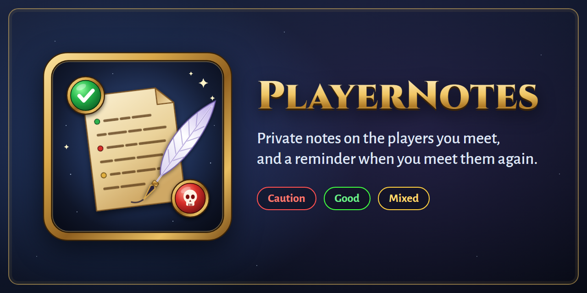

# PlayerNotes

**Remember who you played with.** PlayerNotes keeps private notes and categories on other players for WoW Forever. When one of them invites you, joins your group, shows up in the group finder or walks past you, it reminds you what you wrote.

Your notes stay on your computer. Nothing is sent to the server or to other players, and reminders appear only in your own chat window.

---

## Features

- **Notes and categories:** write a free-text note on any player and tag them with categories such as *Helpful*, *Skilled*, *Ninja* or *Toxic*.
- **Positive and negative categories:** every category is positive, negative or neutral, so you can see at a glance whether a player is someone to group with again or someone to avoid. A player who has both kinds shows as *Mixed*.
- **Outstanding players:** mark the players you never want to forget with a crown. They're always at the top of your list, highlighted in legendary orange, and their mark comes first in every reminder and tooltip.
- **Roles:** note whether a player plays *Tank*, *Healer* or *DPS* (or leave it at *n/a*). The role icon shows next to their name in the list, in reminders and in tooltips, and you can list all your tanks or healers when you need one.
- **Reminders in chat:** you get a reminder when you invite someone you have a note on, when they invite you or ask to join, and when they end up in your group. Each reminder starts with **Caution**, **Good** or **Mixed**, then shows the categories and the note.
- **Group finder icons:** listings whose leader or members you have notes on show your category icons next to the name. Hover the icons to read the notes.
- **Player tooltips:** hover a player to see your verdict, categories and the start of your note.
- **Nearby alert:** when a player in an alerting category comes close, you get an on-screen warning and a sound. Only *Griefer* alerts by default; you can turn alerts on for any category.
- **Online status:** the window shows whether the selected player is online, from your group, friends, guild or a `/who` you start with a click.
- **Dated notes:** new notes start with the date and the zone you were in, so you know where it happened.
- **Right-click menus:** right-click a player's portrait, name in chat, or entry in your friend or guild list and choose *Add note* or *Edit note*, tick *Outstanding*, or set their *Role*.
- **Minimap button:** left-click opens the window. Right-click opens the options.

## The window

Type `/pn` or click the minimap button.

- **Left side:** everyone you have a note on. You can search by name or note text, filter by category (or *Outstanding*, *All negative* / *All positive*, *Tanks*, *Healers*, *DPS*), and sort by name, last change, date added or category. Outstanding players always stay at the top, highlighted in orange. A coloured bar on each row shows the verdict.
- **Right side:** the selected player's note and categories. Click **Role** to choose Tank, Healer, DPS or n/a. Tick **Outstanding** (next to *Categories*) for a player you never want to forget. Click **New** for a new player, or **Use target** to fill in your target's name. **Add dated line** starts a new line with today's date and zone.
- **Categories:** grouped under *Positive*, *Negative* and *Neutral*. Right-click a category to change its type, pick its icon, switch its nearby alert on or off, or delete it. You can create your own categories below the list, up to 20 in total.

Your changes are saved when you click **Save**, select another player or close the window, so nothing you type is lost.

## Default categories

| Positive | Negative |
|---|---|
| Social | Griefer *(nearby alert)* |
| Helpful | Ninja |
| Skilled | Scammer |
| Generous | Toxic |
| | Asocial |
| | Unhelpful |
| | Quitter |

You can delete any of them, change their type or icon, and add your own.

## Commands

`/pn` and `/playernotes` work the same way.

| Command | What it does |
|---|---|
| `/pn` | Open or close the window |
| `/pn add <player> <text>` | Add text to your note on a player |
| `/pn cat <player> <category> [category...]` | Switch categories on or off for a player |
| `/pn show <player>` | Print your note on a player |
| `/pn del <player>` | Delete your note on a player |
| `/pn star <player>` | Mark a player as outstanding, or take the mark off (`/pn star target` works too) |
| `/pn role <player> <tank \| healer \| dps \| none>` | Set the role a player plays; `none` sets it back to n/a (`/pn role healer` uses your target) |
| `/pn list [category \| negative \| positive \| outstanding \| tank \| healer \| dps]` | List the players you have notes on |
| `/pn cats` | List the categories |
| `/pn newcat [+\|-]<name>` | Create a category: `+` for positive, `-` for negative, neither for neutral |
| `/pn delcat <name>` | Delete a category |
| `/pn type <category> <positive \| negative \| neutral>` | Change a category's type |
| `/pn icon [<category> <icon>]` | List the icons, or give a category one |
| `/pn alert [sound \| <category>]` | Turn nearby alerts on or off, their sound, or one category's alert |
| `/pn dates` | Turn the date and zone on new notes on or off |
| `/pn minimap` | Show or hide the minimap button |
| `/pn debug` | Show what the addon can see on your client, for bug reports |

Player names are written in full, as in `/pn add Fetto Vandike rolled need on everything`.

## Installation

1. Download the [latest release](https://github.com/Elagym/PlayerNotes/releases), or install it with the CurseForge app.
2. Put the `PlayerNotes` folder in `World of Warcraft\_forever_\Interface\AddOns\`.
3. Restart the game, or type `/reload` if you are updating.

Your notes are saved per account, so all your characters share them.

## Good to know

- **`/who` cannot see the other faction.** If the online check finds nobody, the player may still be online.
- **The nearby alert depends on nameplates.** It notices players whose nameplate, mouseover or target you can see. Turn on enemy and friendly player nameplates for the best results.
- **Each alert has a cooldown.** A reminder for the same player appears at most once every 2 minutes, and a nearby alert at most once every 5 minutes.
- **A name can match loosely.** If the game shows only a first name, PlayerNotes can match it to a note on a player with that first name. It then tells you the match may be a different player.

## Reporting a problem

Please [open an issue](https://github.com/Elagym/PlayerNotes/issues) with:

- what you did and what happened;
- the output of `/pn debug`;
- any Lua error you got, if any.

## Licence

PlayerNotes is released under the [MIT License](LICENSE).
